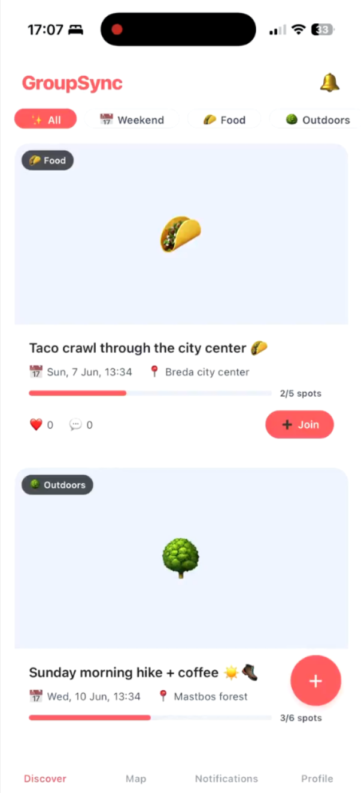
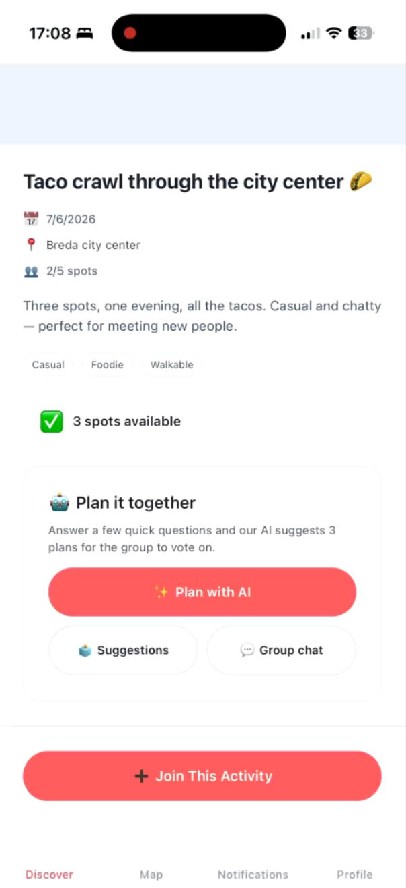
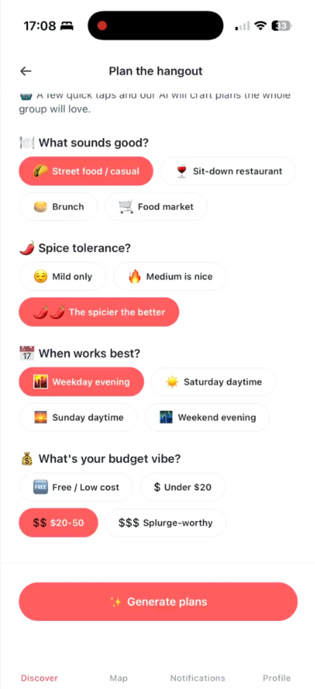
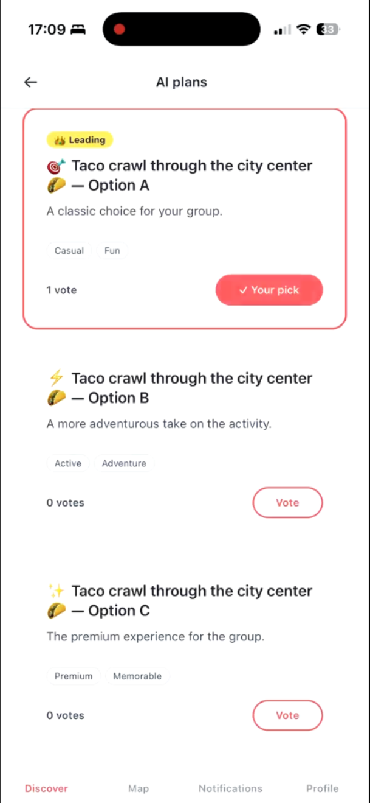
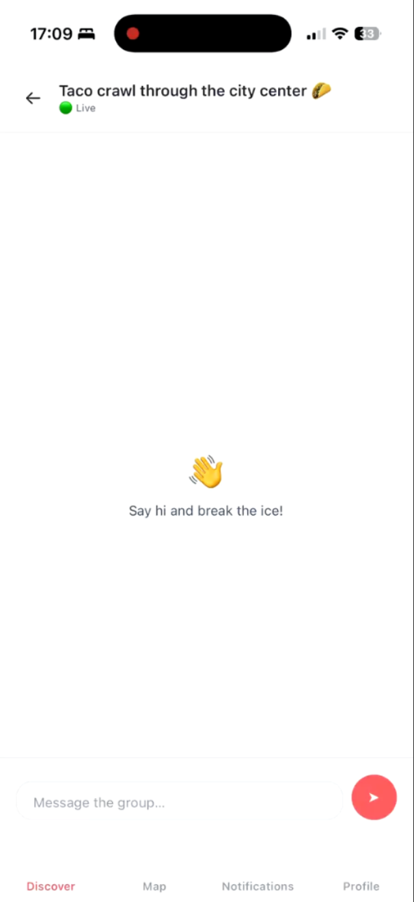

# GroupSync

**Meet people through activities you actually want to do — not by swiping on profiles.**

GroupSync is a mobile app that helps people make real-life friends by joining small group activities. Instead of matching with strangers and hoping a conversation goes somewhere, you pick something fun to do — tacos, a hike, board games, a pottery class — join a small group of 3–5 people, and an AI helps the group plan the actual hangout. You meet people by *doing things together*.

**Status:** working prototype (React Native app + Node/Express API). AI planning calls OpenAI (gpt-4o-mini); without an API key it falls back to generic suggestions. Stripe payments are not implemented yet; Premium is a database flag.

## Screenshots

<table>
  <tr>
    <td align="center"> Discover activities</td>
    <td align="center"> Join an activity</td>
    <td align="center"> Group questionnaire</td>
    <td align="center"> AI plans and voting</td>
    <td align="center"> Live group chat</td>
  </tr>
</table>

---

## Why this app exists

Making friends as an adult is genuinely hard. After school, there's no built-in way to meet people, and it's only gotten harder since the pandemic. The apps that exist mostly copy the dating model: endless profiles, swiping, and shallow small talk that rarely turns into a real friendship. They optimise for *who* you might like, not for *doing* anything together.

GroupSync flips that around. The starting point isn't a person — it's an **activity**. Research and plain experience both say the same thing: shared experiences build connection far faster than chatting through a screen. So GroupSync gets a few like-minded people into the same place doing something they all enjoy, and lets friendship happen naturally from there.

There's also a small but real friction that kills a lot of group plans: *"okay, but what do we actually do, and where?"* Coordinating time, budget, and taste across a group is annoying, so plans fizzle out. GroupSync removes that friction with an **AI planner**: everyone answers a few quick questions, and the AI proposes concrete options the group votes on.

**The goal in one sentence:** more than half of the activities people plan should actually happen — real meetups, real friendships.

---

## How it works

1. **Sign up & onboard** — create an account, write a short bio, and pick at least 3 interests so the feed can match your vibe.
2. **Discover** — browse a visual feed of nearby activities, filterable by category. Each shows the category, time, place, and how many spots are filled.
3. **Join** — tap an activity to see the details and grab a spot. Groups are deliberately small (3–5 people).
4. **Plan with AI** — everyone answers a quick questionnaire (time, budget, vibe). The AI turns the group's combined preferences into 3 concrete plans — each with a venue type, timing, and price (when OpenAI is connected).
5. **Vote** — the group votes on its favourite plan; the winner rises to the top.
6. **Group chat** — a real-time chat opens so the group can sort out the final details.
7. **Meet up** — and turn an activity into actual friendships.

An activity moves through clear stages along the way: `forming` → `planning` → `confirmed` → `completed`.

---

## What makes it different

- **Activity-first, not profile-first** — you commit to an experience, not a person.
- **AI removes the planning friction** — no more "what should we do?" group-chat paralysis.
- **Small groups by design** — 3–5 people, so it actually feels personal.
- **Built around real meetups** — the whole product is measured by whether plans turn into real-life hangouts.

---

## Tech stack

**Mobile app** (`groupsync-app/`)
- React Native + Expo (iOS & Android), TypeScript
- React Navigation, Zustand (state), Axios, Socket.IO client
- Secure token storage with `expo-secure-store`

**Backend API** (`groupsync-api/`)
- Node.js + Express, TypeScript
- PostgreSQL
- JWT authentication (bcrypt password hashing)
- Socket.IO for real-time group chat
- OpenAI for AI activity planning (with a built-in fallback)

---

## Business model

Freemium. Free users can join up to 3 activities per month; Premium (€11.99/month) unlocks unlimited joining and the ability to host your own activities.

---

## Demo

A full walkthrough of the app (~5 min) is included in this repo: [`demo/groupsync-demo.mp4`](demo/groupsync-demo.mp4). Open the file on GitHub to play it directly in the browser.

> The demo is a silent visual walkthrough — see the **How it works** section above for the full explanation of each step shown in the video.

---

*Built by Floris Snelders — Year 1 Data Science & AI, BUas — for the After-the-Block Challenge (Challenge C).*
